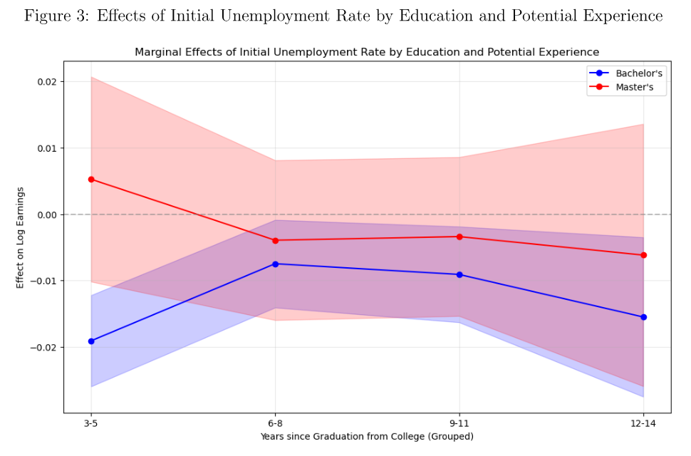
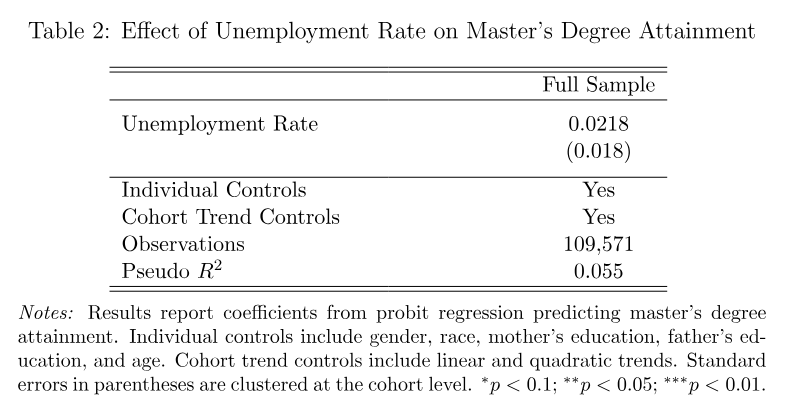

# Graduate Education and Earnings During Economic Downturns

**Sijia Chen · Recession-Proof? Evaluating Graduate Education as a Strategy During Economic Downturns**

## Project overview

Can graduate education offset the earnings penalty associated with graduating during an economic downturn? This paper uses the National Survey of College Graduates to compare the relationship between unemployment at bachelor's graduation and subsequent earnings for bachelor's and master's degree holders.

Measuring initial conditions at bachelor's graduation gives both groups a common starting point. The analysis follows earnings patterns across years since college graduation and examines selection into subsequent master's attainment.

## Main findings

- In the first **3–5 years** after bachelor's graduation, each percentage-point increase in initial unemployment is associated with approximately **1.91% lower earnings** for bachelor's degree holders.
- The master's interaction is **+0.0243 log points** per percentage-point increase in unemployment—approximately a **2.43-percentage-point offset** to that earnings response. The point estimate therefore offsets the bachelor's penalty in the early-career group.
- The interaction remains positive at later career stages, but becomes smaller and is not statistically significant. The strongest evidence of a differential response is in early career.
- The pooled attainment probit does not find a statistically clear relationship between initial unemployment and subsequent master's attainment. Observable-composition checks provide additional evidence on selection.

The comparison does not establish a causal return to obtaining a master's degree: selection on unobserved characteristics remains possible.

## Key figure and table

### Earnings response by education and years since graduation



The figure plots the estimated log-earnings response to a one-percentage-point increase in unemployment at bachelor's graduation. The master's early-career point estimate combines −0.0191 and +0.0243; a significant interaction does not itself establish that this combined effect differs from zero. Source: paper Figure 3, p. 13; coefficients in Table 3, p. 12.

### Selection into master's attainment



The probit controls for gender, race, age, parental education, and linear and quadratic cohort trends, with standard errors clustered by graduation cohort. The unemployment coefficient is 0.0218 (SE 0.018); it is a probit coefficient, not a probability marginal effect. Source: paper Table 2, p. 8.

## Code and reproducibility

All code is organized in one directory:

```text
code/
  data_process/   # source-data cleaning and analysis-data construction
  analysis/       # final specifications, robustness checks, tables and figures
```

Start with the [code guide](docs/CODE_GUIDE.md) for the run order, source-data downloads and the mapping to the final paper/slides. [Validation](docs/VALIDATION.md) distinguishes executed checks from unresolved replication steps. [Source manifest](docs/SOURCE_MANIFEST.json) records original files and selected notebook cells.
